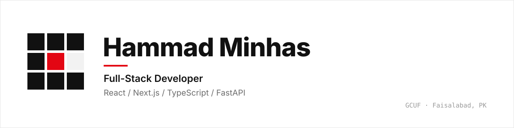

<picture>
  <source media="(prefers-color-scheme: dark)" srcset="./assets/hero-dark.svg">
  
</picture>

  
  
  
  

 

### About

I'm a Software Engineering student at **Government College University Faisalabad** (2024–2028). I build complete web products, not just screens.

- **Front end:** React 19, Next.js 16 and TypeScript, with accessibility (WCAG 2.2 AA), SEO and performance treated as requirements.
- **Back end:** FastAPI and Cloudflare Pages Functions + D1, including auth, booking rules and server-side validation.
- **Quality:** Playwright + axe tests, Lighthouse CI budgets, strict TypeScript and per-page Content-Security-Policy.
- **Beyond the web:** a 48-lesson course on Computer Organization & 8086 Assembly, and an NTFS file-recovery tool in C++.

 

### Stack

**Languages** 

**Frameworks** 

**Testing, data &amp; deployment** 

 

### Selected work

| | Project | Stack |
|---|---|---|
| 01 | **[COAL Docs](https://hammadhanif67.github.io/assembly-language-docs/)**: course site for Computer Organization & Assembly Language. 48 lessons, 53 diagrams, 16 calculators that show their working. · [code](https://github.com/hammadhanif67/assembly-language-docs) | JavaScript · CSS |
| 02 | **[Karakoram Trails](https://karakoram-trails.pages.dev)**: tour-booking platform for Northern Pakistan with live pricing, seat holds and an admin. · [code](https://github.com/hammadhanif67/karakoram-trails) | Next.js 16 · Cloudflare D1 |
| 03 | **[AI Resume Analyzer](https://github.com/hammadhanif67/AI-Resume-Analyzer)**: full-stack resume screening with 33 REST endpoints, ATS scoring, job matching and PDF reports. | FastAPI · React · TypeScript |
| 04 | **[Downsize](https://downsize-alpha.vercel.app)**: image resizer, compressor and converter that runs entirely in the browser, with no uploads. · [code](https://github.com/hammadhanif67/Downsize) | React 19 · TypeScript |
| 05 | **[VistechBot](https://vistechbotaipk.vercel.app)**: marketing site for an AI customer-support SaaS with design-token theming and build-time SEO. · [code](https://github.com/hammadhanif67/VistechBot) | React 19 · GSAP |
| 06 | **[LinkAura](https://link-aura-ruby.vercel.app)**: curated directory of websites, AI tools, books and research resources. · [code](https://github.com/hammadhanif67/LinkAura) | React · TypeScript |

 

### Activity

<picture>
  <source media="(prefers-color-scheme: dark)" srcset="https://streak-stats.demolab.com?user=hammadhanif67&background=00000000&hide_border=true&ring=E30613&fire=E30613&currStreakLabel=E30613&currStreakNum=F5F5F5&sideNums=F5F5F5&sideLabels=9A9A9A&dates=6B6B6B&stroke=262626">
  
</picture>

<picture>
  <source media="(prefers-color-scheme: dark)" srcset="https://raw.githubusercontent.com/hammadhanif67/hammadhanif67/output/grid-dark.svg">
  
</picture>

 

### Business

I also run **[Trenvo Media](https://github.com/trenvo-media)**, a performance-marketing studio that handles paid media, creative production and measurement as one system. · [trenvomedia.com](https://www.trenvomedia.com)

### Contact

[LinkedIn](https://www.linkedin.com/in/hammad-minhas-ab9109402/) · [Portfolio](https://hammad-minhas-portfolio.vercel.app) · Faisalabad, Pakistan · open to remote and on-site roles
