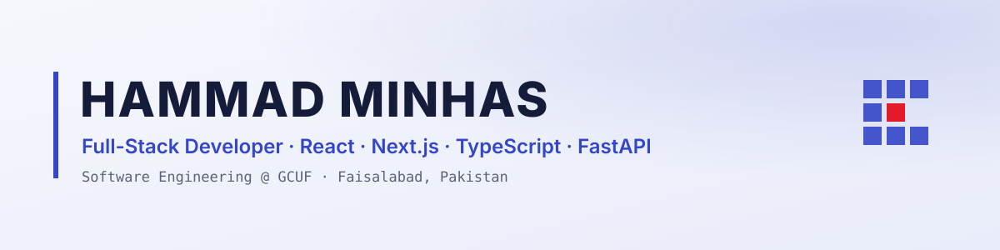

<picture>
  <source media="(prefers-color-scheme: dark)" srcset="./assets/banner-dark.svg">
  
</picture>

  
  
  
  

## About

I'm a Software Engineering student at **Government College University Faisalabad** (2024–2028) who builds complete web products, not just screens.

- **Front end:** React 19, Next.js 16 and TypeScript, with accessibility (WCAG 2.2 AA), SEO and performance treated as requirements.
- **Back end:** FastAPI and Cloudflare Pages Functions + D1, including auth, booking rules and server-side validation.
- **Quality:** Playwright + axe tests, Lighthouse CI budgets, strict TypeScript and per-page Content-Security-Policy.
- **Beyond the web:** a 48-lesson course site on Computer Organization & 8086 Assembly, and an NTFS file-recovery tool in C++.

## Tech stack

  
   
  
   
  

**Also:** Framer Motion · GSAP · React Router · Playwright · axe-core · Lighthouse CI · ESLint · Prettier · CMake

## Featured projects

| Project | What it is | Stack | Links |
|---|---|---|---|
| **[COAL Docs](https://github.com/hammadhanif67/assembly-language-docs)** | Course site for Computer Organization & Assembly Language: 48 lessons, 53 diagrams, 16 calculators that show their working | JavaScript · CSS | [Live](https://hammadhanif67.github.io/assembly-language-docs/) |
| **[Downsize](https://github.com/hammadhanif67/Downsize)** | Image resizer, compressor and converter that runs entirely in the browser, with no uploads | React 19 · TypeScript · Tailwind v4 | [Live](https://downsize-alpha.vercel.app) |
| **[AI Resume Analyzer](https://github.com/hammadhanif67/AI-Resume-Analyzer)** | Full-stack resume screening: 33 REST endpoints, ATS scoring, job matching, PDF reports, admin panel | FastAPI · React · TypeScript · SQLite | [Code](https://github.com/hammadhanif67/AI-Resume-Analyzer) |
| **[Karakoram Trails](https://github.com/hammadhanif67/karakoram-trails)** | Tour-booking platform for Northern Pakistan with live pricing, seat holds and an admin | Next.js 16 · Cloudflare D1 · Framer Motion | [Code](https://github.com/hammadhanif67/karakoram-trails) |
| **[VistechBot](https://github.com/hammadhanif67/VistechBot)** | Marketing site for an AI customer-support SaaS with design-token theming and build-time SEO | React 19 · Vite · GSAP | [Live](https://vistechbotaipk.vercel.app) |
| **[LinkAura](https://github.com/hammadhanif67/LinkAura)** | Curated directory of websites, AI tools, books and research resources | React · TypeScript · Tailwind | [Live](https://link-aura-ruby.vercel.app) |

## GitHub stats

  
  

## Contribution activity

<picture>
  <source media="(prefers-color-scheme: dark)" srcset="https://raw.githubusercontent.com/hammadhanif67/hammadhanif67/output/github-contribution-grid-snake-dark.svg">
  
</picture>

## Business

I also run **[Trenvo Media](https://github.com/trenvo-media)**, a performance-marketing studio that handles paid media, creative production and measurement as one system. Website: [trenvomedia.com](https://www.trenvomedia.com) · GitHub: [@trenvo-media](https://github.com/trenvo-media)

## Contact

- **LinkedIn:** [hammad-minhas-ab9109402](https://www.linkedin.com/in/hammad-minhas-ab9109402/)
- **Portfolio:** [hammad-minhas-portfolio.vercel.app](https://hammad-minhas-portfolio.vercel.app)
- **Location:** Faisalabad, Pakistan · open to remote and on-site roles
