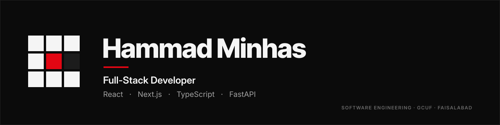
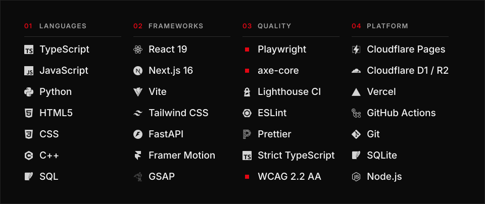
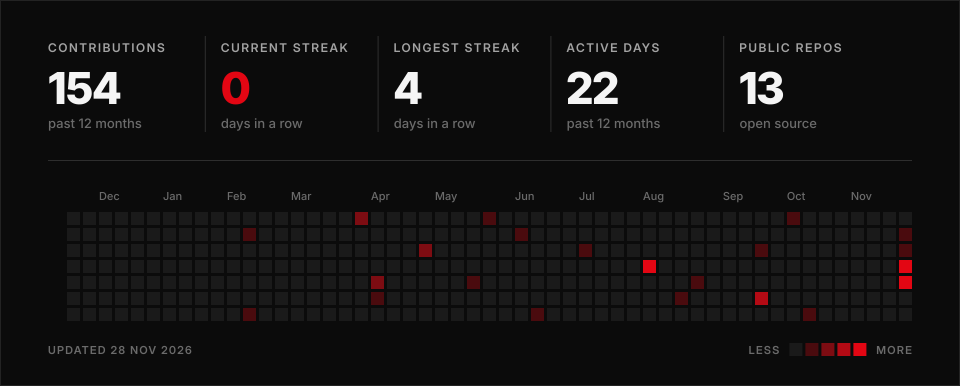

  &nbsp;
  &nbsp;
  &nbsp;
  

 

### About

Software Engineering student at **Government College University Faisalabad** (2024–2028). I build complete web products, from the interface to the API to the tests that keep them working.

- **Front end:** React 19, Next.js 16 and TypeScript, with accessibility (WCAG 2.2 AA), SEO and performance treated as requirements.
- **Back end:** FastAPI and Cloudflare Pages Functions + D1, including authentication, booking rules and server-side validation.
- **Quality:** Playwright and axe tests, Lighthouse CI budgets, strict TypeScript and per-page Content-Security-Policy.
- **Fundamentals:** a 48-lesson course on Computer Organization & 8086 Assembly, and an NTFS file-recovery tool in C++.

 

### Stack

 

### Selected work

| No. | Project | Built with |
|:---:|---|---|
| 01 | **[COAL Docs](https://hammadhanif67.github.io/assembly-language-docs/)**: course site for Computer Organization & Assembly Language, with 48 lessons, 53 diagrams and 16 calculators that show their working. [Source](https://github.com/hammadhanif67/assembly-language-docs) | JavaScript · CSS |
| 02 | **[Karakoram Trails](https://karakoram-trails.pages.dev)**: tour-booking platform for Northern Pakistan with live pricing, seat holds and an admin. [Source](https://github.com/hammadhanif67/karakoram-trails) | Next.js 16 · Cloudflare D1 |
| 03 | **[AI Resume Analyzer](https://github.com/hammadhanif67/AI-Resume-Analyzer)**: full-stack resume screening with 33 REST endpoints, ATS scoring, job matching and PDF reports. | FastAPI · React · TypeScript |
| 04 | **[Downsize](https://downsize-alpha.vercel.app)**: image resizer, compressor and converter that runs entirely in the browser, with no uploads. [Source](https://github.com/hammadhanif67/Downsize) | React 19 · TypeScript |
| 05 | **[VistechBot](https://vistechbotaipk.vercel.app)**: marketing site for an AI customer-support SaaS with design-token theming and build-time SEO. [Source](https://github.com/hammadhanif67/VistechBot) | React 19 · GSAP |
| 06 | **[LinkAura](https://link-aura-ruby.vercel.app)**: curated directory of websites, AI tools, books and research resources. [Source](https://github.com/hammadhanif67/LinkAura) | React · TypeScript |

 

### Activity

 

### Business

I also run **[Trenvo Media](https://github.com/trenvo-media)**, a performance-marketing studio that runs paid media, creative production and measurement as one system. [trenvomedia.com](https://www.trenvomedia.com)

 

Faisalabad, Pakistan · open to remote and on-site roles · <a href="https://www.linkedin.com/in/hammad-minhas-ab9109402/">LinkedIn</a> · <a href="https://hammad-minhas-portfolio.vercel.app">Portfolio</a>
